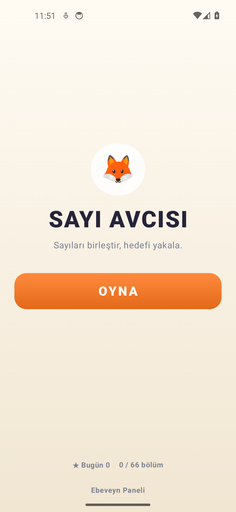
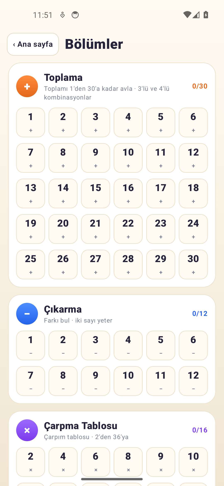
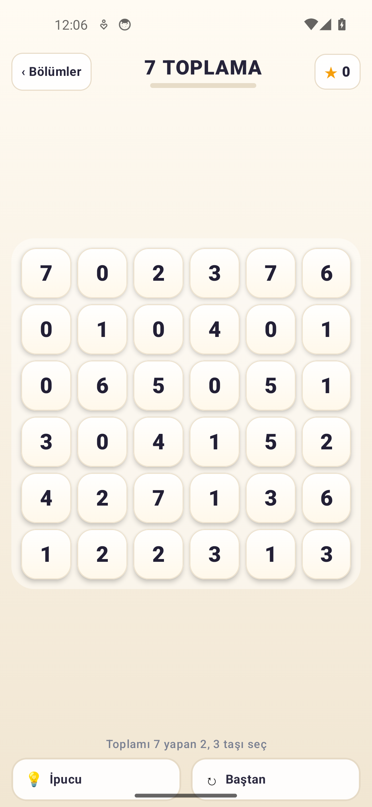
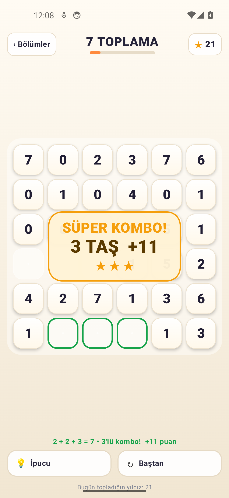
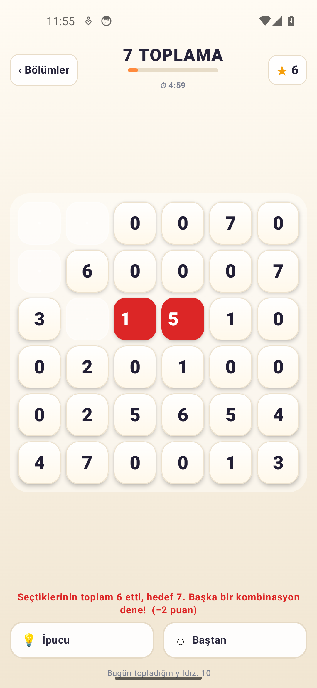
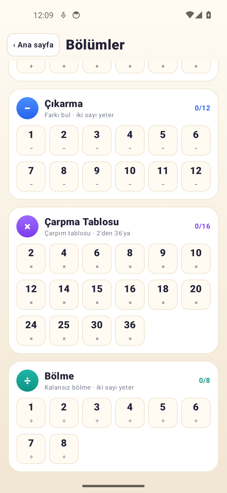

# 🦊 SAYI AVCISI — Çocuklar İçin Sayı Avlama Oyunu (Android APK)

**SAYI AVCISI**, toplama, çıkarma, çarpma ve bölmeyi oyun oynayarak pekiştiren,
**Kotlin & Jetpack Compose** ile yazılmış, **%100 çevrimdışı** çalışan bir Android bulmaca oyunudur.

Bir sayıya basılı tut, parmağını komşu sayılara sürükle ve bırak. Hamle kendiliğinden kontrol edilir:
doğruysa taşlar yeşil parlar, yanlışsa kırmızı olup sarsılır ve puan azalır. Düğmeye basmak yok.

> **3.0.0 oyunu baştan sadeleştirdi.** Ekranın üstünde artık yalnızca bölüm adı (“7 toplama”) ve
> yıldız puanı var. Hedef kartları, joker kutuları ve bilgi şeritleri kaldırıldı. Toplamada
> **2, 3 ve 4 taşlı** kombinasyonlar geçerli; hedefin bütün kombinasyonları tahtaya eşit dağıtılır.
> Çarpım tablosu dahil bütün bölümler açıktır.

---

## 📲 KURULUM DOSYASI (APK)

Derlenmiş ve doğrudan Android telefon/tabletlere kurulmaya hazır **APK v3.0.0**:

- 🚀 **Doğrudan indirme (ana paket):**
  👉 **[https://github.com/ardaozkul/SAYI-AVCISI/raw/main/SAYI-AVCISI.apk](https://github.com/ardaozkul/SAYI-AVCISI/raw/main/SAYI-AVCISI.apk)**
- 📦 GitHub üzerinde APK dosyası:
  👉 **[SAYI-AVCISI.apk](https://github.com/ardaozkul/SAYI-AVCISI/blob/main/SAYI-AVCISI.apk)**
- 📂 Alternatif kopyalar:
  - [`apk/SAYI-AVCISI-release.apk`](https://github.com/ardaozkul/SAYI-AVCISI/raw/main/apk/SAYI-AVCISI-release.apk)
  - [`apk/SAYI-AVCISI-debug.apk`](https://github.com/ardaozkul/SAYI-AVCISI/raw/main/apk/SAYI-AVCISI-debug.apk)
- 🌐 **Giriş / bilgilendirme sayfası:** [`index.html`](index.html) — APK adresi, kurulum adımları ve ekran görüntüleri.

**Gereksinim:** Android 7.0 (API 24) ve üzeri · ~12 MB · İnternet gerekmez · İlerleme cihazda saklanır.

### 3 adımda kurulum
1. Telefonun tarayıcısından APK bağlantısına dokun ve dosyayı indir.
2. Android “Bilinmeyen kaynaklardan uygulama yükleme” izni isterse bir kez onayla.
3. “Sayı Avcısı” simgesine dokun; oyun çevrimdışı açılır.

---

## 🎮 NASIL OYNANIR

| Adım | Ne olur |
|:---|:---|
| 1 | Bir sayıya **basılı tut**. Taş sarıya döner. |
| 2 | Parmağını **komşu sayılara sürükle**. Taşlar sarıdan turuncuya ısınır. |
| 3 | Parmağını **bırak**. Hamle otomatik kontrol edilir; “EŞLEŞTİR” düğmesi yoktur. |
| ✓ | Doğruysa taşlar yeşil parlayıp patlar, puan üstteki yıldıza uçar. |
| ✗ | Yanlışsa taşlar kırmızı olup sarsılır ve bölüm puanından **2 puan** gider. |

- **Komşuluk:** Yatay, dikey ve çapraz komşular geçerlidir. Aralarında taş kalmayan uzak sayılar
  da (ör. aynı satırdaki `2` ve `5`) komşu sayılır. Düz giderken çapraza dönebilirsin.
- **Grup boyutu:** Toplamada 2, 3 veya 4 taş; çıkarma/çarpma/bölmede 2 taş.
- **Tek dokunuşla oynayanlar:** İki veya daha fazla taş seçili kalınca kısa bir bekleyişten sonra
  hamle kendiliğinden kontrol edilir.
- **Yıldız desteği:** Geçerli hamle kalmazsa oyun ücretsiz olarak kalan taşları yeniden dizer;
  puan/joker gitmez, ekranda yıldız efektiyle duyurulur.

---

## 🆕 3.0.0 — NELER DEĞİŞTİ

### 1. Bütün kombinasyonlar eşit
- Tahta, hedefin **tüm** kombinasyonlarını içeren karıştırılmış bir desteden doldurulur.
  “4 toplamı” bölümünde `0+4`, `1+3` ve `2+2` aynı sıklıkta gelir; tek bir kombinasyona sıkışmaz.
- Toplamada `1+2+3`, `1+1+5`, `0+0+7` gibi üçlüler ve `0+1+2+4` gibi dörtlüler de geçerli.
- Sıra ve yön önemsizdir: `1+4` ile `4+1`, `9−4` ile `4−9` aynı kabul edilir.

### 2. Yeni parmak sürükleme ve geri bildirim
- Basılı tutup sürükleyerek 2–4 taş seçilir; bırakınca hamle otomatik denenir.
- Seçim sarı→turuncu; doğru hamlede yeşil parlama + patlama, yanlışta kırmızı + sarsılma.
- Yanlış hamle bölüm puanından 2 puan götürür (puan 0’ın altına inmez).

### 3. Kombo kutlaması
- 3 taşlı komboda **SÜPER KOMBO**, 4 taşlı komboda **MÜTHİŞ KOMBO** kartı belirir.
- Kocaman yazan puan, yıldız patlaması ve yukarıdaki yıldız sayacına doğru süzülen efekt.
- Kombo puanı: 3 taş **+5**, 4 taş **+12** ekstra (üstüne seri ve tahta bonusu).

### 4. Sade tasarım
- Sıcak krem zemin, beyaz taşlar, koyu rakamlar; doğru yeşil, yanlış kırmızı.
- Üstte yalnızca **bölüm adı** (“7 toplama”), ince ilerleme çizgisi ve **★ puan**.
- Hedef kartı, joker kutuları, günlük tavan kutuları ve “nasıl oynanır” katmanı kaldırıldı.
- Düğmeler ikon değil, yazılı: “İpucu” ve “Baştan”.

### 5. Yeni bölüm yapısı — 66 bölüm, hepsi açık
| Bölüm | İçerik | Tahta |
|:---|:---|:---|
| ➕ Toplama | 1’den 30’a ardışık hedefler; 3’lü ve 4’lü kombinasyonlar | 1–3 için 4×4, 4–30 için 6×6 |
| ➖ Çıkarma | Farkı 1–12 | 4×4 / 6×6 |
| ✖️ Çarpma Tablosu | 2, 4, 6 … 36 (16 hedef) | 4×4 / 6×6 |
| ➗ Bölme | Kalansız bölme, 1–8 | 4×4 / 6×6 |

- Kilit yoktur: çocuk veya veli istediği bölümü açıp deneyebilir; tamamlananlar ✓ ile işaretlenir.
- Toplamanın ilk üç hedefinde kombinasyon sayısı az olduğu için tahta küçültülür.

---

## 📸 EKRAN GÖRÜNTÜLERİ (3.0.0)

Kareler Android emülatöründe kurulu yeni APK’dan gerçek oynanışla alındı.

| Giriş | Bölümler | 7 Toplama |
|:---:|:---:|:---:|
|  |  |  |

| 3’lü Kombo | Yanlış Hamle | Tüm Bölümler |
|:---:|:---:|:---:|
|  |  |  |

> Eski 2.0.0 kareleri [`docs/screenshots`](docs/screenshots) klasöründe tarihsel olarak durur;
> yeni tasarımın kareleri [`docs/screenshots/v3`](docs/screenshots/v3) altındadır.

---

## 🛠️ KAYNAK KODDAN DERLEME

```bash
git clone https://github.com/ardaozkul/SAYI-AVCISI.git
cd SAYI-AVCISI
./gradlew testDebugUnitTest assembleDebug assembleRelease
# debug   -> app/build/outputs/apk/debug/app-debug.apk
# release -> app/build/outputs/apk/release/app-release.apk
```

- Kotlin, Jetpack Compose (BOM 2025.12.01), minSdk 24, targetSdk 35.
- Sürüm: `versionCode 4`, `versionName 3.0.0`.
- Release APK, projede tanımlı debug imzasıyla üretilir; mağaza dışı kurulum içindir.

### Mimari
```
model/GameModels.kt         LevelSpec, Board, BlockCell, MatchResult
engine/RuleEngine.kt        komşuluk/çizgi geometrisi, sıra bağımsız matematik, tüm kombinasyonlar
engine/BoardBuilder.kt      garantili tahta döşemesi + kombinasyon destesi
engine/BoardDoctor.kt       ipucu, tıkanma tespiti, yıldız desteği
engine/CurriculumRepository 4 bölüm / 66 bölüm müfredatı
engine/ScoreEngine.kt       puan, kombo bonusu, yanlış ceza, ödüller
engine/GameSession.kt       sürükleme, otomatik kontrol, kayıt/geri yükleme
engine/ProgressRules.kt     bütün bölümler açık, tamamlanan işaretleri
data/LocalProgressStorage   SharedPreferences: ilerleme, istatistik, yarım tahta
ui/GameScreen.kt            sade oyun ekranı, sürükleme katmanı, kombo efekti
ui/GameScreenParts.kt       taş (sarı/turuncu/yeşil/kırmızı), yazılı düğmeler
ui/GameEffects.kt           popIn, shake, parçacık, yıldız, konfeti, halka, çizgi
ui/StartScreen.kt           sade giriş
ui/AdventureMapScreen.kt    dört bölüm kartı ve hedef çipleri
ui/ParentPanelScreen.kt     ebeveyn paneli (istatistik/ayarlar)
```

---

## ✅ TESTLER

`app/src/test/java/com/sayiavcisi/app/EngineRulesTest.kt` — **23 test, 0 başarısız**:

- Toplamada bütün ikili/üçlü/dörtlü kombinasyonlar kabul edilir; ters sıra da geçerli.
- `0+4`, `1+3`, `2+2` aynı tahtada bulunur (eşit dağıtım).
- Düz giderken çapraza dönme ve aralarında taş kalmayan uzak sayılar geçerli.
- 66 bölüm × 2 tohum: her tahta tamamen kapanır, her grup hedefi tutar.
- Plan sırasıyla oynanınca tahta temizlenir; rastgele oynanınca yıldız desteği devreye girer.
- 4 taşlı komboda +12 kombo bonusu ve kutlama tetiklenir.
- Yanlış hamlede −2 puan ve seri sıfırlanır.
- Günlük tavan bölüm puanını kesmez; kayıt/geri yükleme ve joker hakları çalışır.
- Müfredat: 30 toplama + 12 çıkarma + 16 çarpma + 8 bölme; hepsi açık.

Ayrıca yeni APK emülatörde kurulup gerçek parmak sürükleme (2’li ve 3’lü kombo), doğru/yanlış
geri bildirimi ve kombo kutlaması adb ile oynanarak doğrulandı.

---

## 🔒 GİZLİLİK

- Hesap, reklam, analitik ve ağ izni yoktur.
- Bütün ilerleme ve istatistikler yalnızca cihazdaki `SharedPreferences` içinde tutulur.
- Ebeveyn panelinden ses, süreli/rahat mod ve ilerleme sıfırlama yönetilebilir.
