# 🦊 SAYI AVCISI – Çocuklar İçin Matematik Bulmaca Oyunu (Android APK)

**SAYI AVCISI**, 3. sınıf seviyesindeki çocukların **toplama (+), çıkarma (−), çarpma (×) ve bölme (÷)** işlemlerini
oyun oynarken pekiştirmesini sağlayan, **Kotlin & Jetpack Compose** ile yazılmış, **%100 çevrimdışı (offline)**
çalışan 5 günlük bir Android matematik bulmaca oyunudur.

Çocuk tahtadaki sayı bloklarını hedefe göre avlar: **bölümde tek bir hedef vardır** (ör. "Toplamı 7"),
tahtadaki **her** blok grubu o hedefi sağlar. Sıra önemli değildir; taşlar yatay, dikey, çapraz ve her iki
yönde de eşleşebilir — aralarında blok kalmadığı anda uzaktaki taşlar da buluşur.

> **2.0.0 motoru baştan yazdı.** 1.x'te çocuk "bazen kabul eden bazen etmeyen" eşleşmeler yaşıyordu
> (çok hedefli bölümler + sıraya duyarlı çıkarma/bölme kontrolü). Şimdi kural tek hedefe indirgendi,
> tüm işlemler sıra gözetmez hale geldi ve her tahta **eşleşmeyen tek blok kalmayacak şekilde** üretiliyor.

---

## 📲 KURULUM DOSYASI (APK) İNDİRME ADRESLERİ

Derlenmiş ve doğrudan Android telefon/tabletlere kurulmaya hazır **APK** dosyaları:

- 🚀 **Doğrudan APK İndirme Adresi (Ana Paket, v2.0.0):**
  👉 **[https://github.com/ardaozkul/SAYI-AVCISI/raw/main/SAYI-AVCISI.apk](https://github.com/ardaozkul/SAYI-AVCISI/raw/main/SAYI-AVCISI.apk)**
- 📦 **GitHub Depo İçi APK Sayfası:**
  👉 **[https://github.com/ardaozkul/SAYI-AVCISI/blob/main/SAYI-AVCISI.apk](https://github.com/ardaozkul/SAYI-AVCISI/blob/main/SAYI-AVCISI.apk)**
- 📂 **Alternatif APK Konumları (Depo İçi):**
  - Release APK: [`apk/SAYI-AVCISI-release.apk`](https://github.com/ardaozkul/SAYI-AVCISI/raw/main/apk/SAYI-AVCISI-release.apk)
  - Debug APK: [`apk/SAYI-AVCISI-debug.apk`](https://github.com/ardaozkul/SAYI-AVCISI/raw/main/apk/SAYI-AVCISI-debug.apk)
  - Web Giriş / Bilgilendirme Sayfası: [`index.html`](https://github.com/ardaozkul/SAYI-AVCISI/blob/main/index.html)

**Gereksinim:** Android 7.0 (API 24) ve üzeri · İndirme boyutu ~12 MB · İnternet gerekmez, tüm ilerleme cihazda saklanır.

---

## 📸 OYUN İÇİNDEN GERÇEK EKRAN GÖRÜNTÜLERİ (v2.0.0)

Aşağıdaki kareler Android emülatöründe (Pixel 5) kurulu **2.0.0 APK**'dan `adb screencap` ile gerçek olarak
alındı; oyunun kendisi `tools/capture-screenshots.mjs` tarafından (uiautomator ile) gerçekten oynanarak üretildi.

| 🦊 Giriş Ekranı | 🗺️ 5 Günlük Macera Haritası |
|:---:|:---:|
| 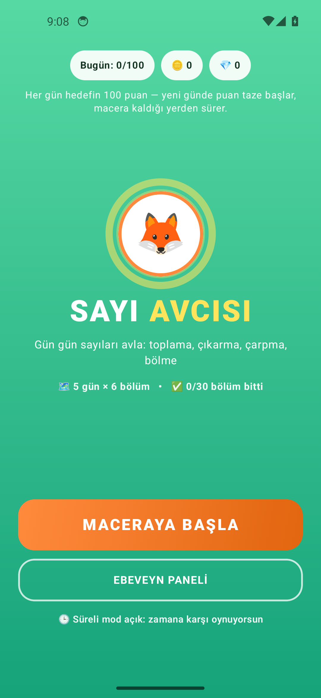 | 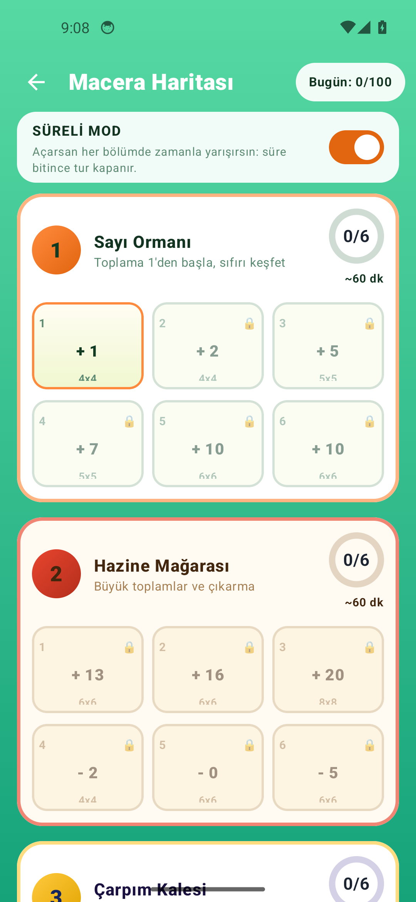 |

| 🌳 1. Gün: Toplama 4×4 | ✨ Eşleşme Sonrası (temizlenen taşlar + puan) |
|:---:|:---:|
| 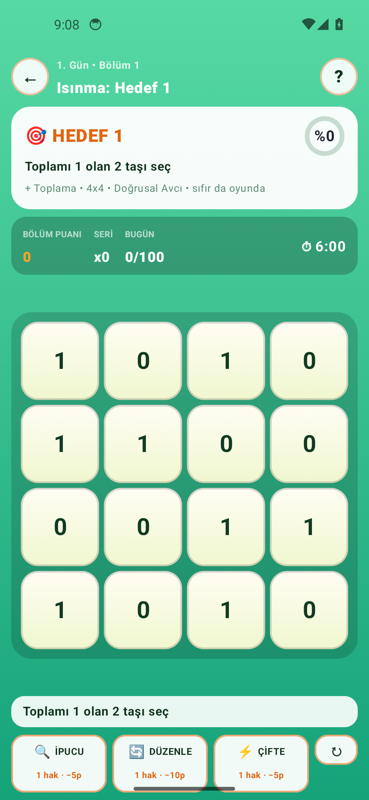 | 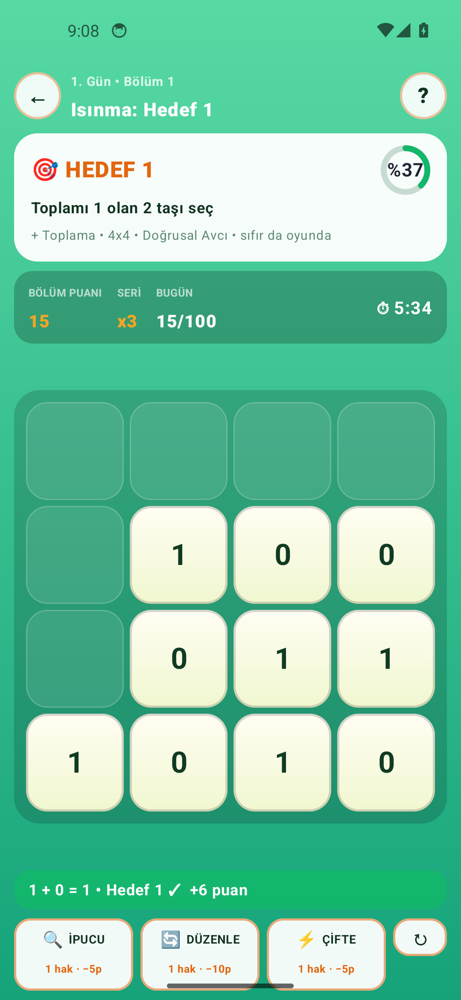 |

| 🎉 Bölüm Bitti Kutlaması | ⛏️ 2. Gün: Çıkarma (Hazine Mağarası) |
|:---:|:---:|
| 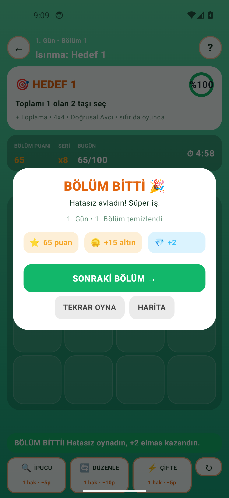 | 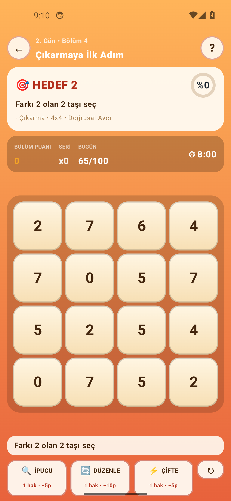 |

| 🏰 3. Gün: Çarpma (Çarpım Kalesi) | 🚀 4. Gün: Bölme (Bölme Uzayı) |
|:---:|:---:|
| 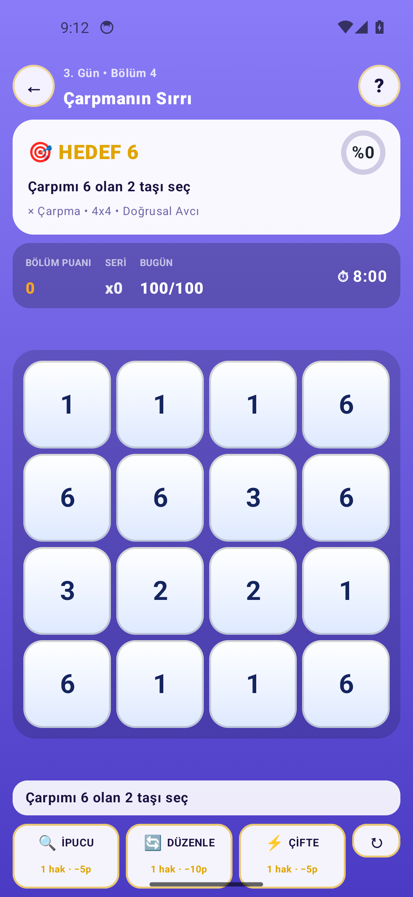 | 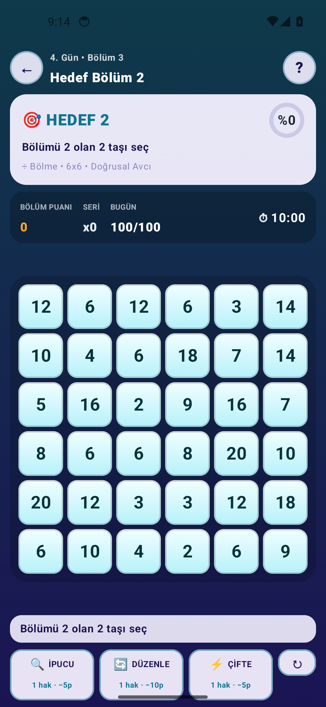 |

| 🏝️ 10×10 Büyük Final (~15 dk) | 🎯 Serbest Mod (yön/mesafe yok) |
|:---:|:---:|
| 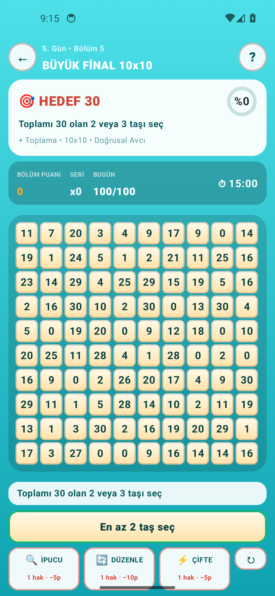 | 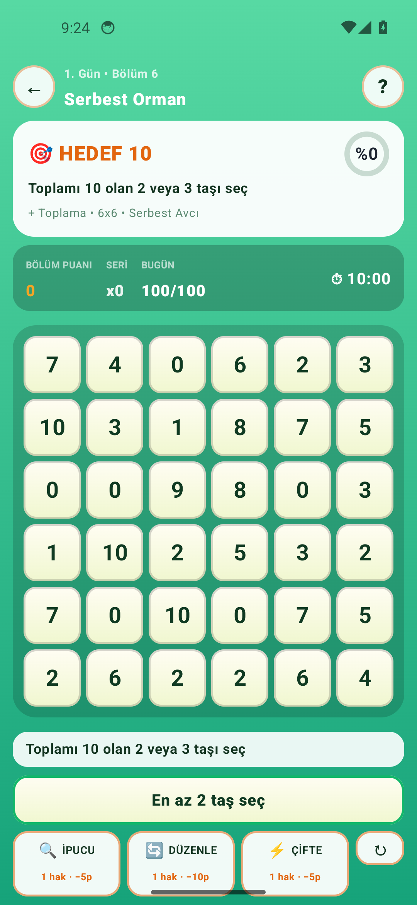 |

| 👨‍👩‍👧 Ebeveyn Paneli | 📊 Günlük İlerleme ve Çarpım Tablosu Analizi |
|:---:|:---:|
| 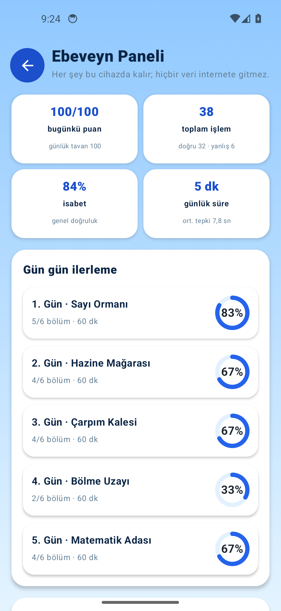 | 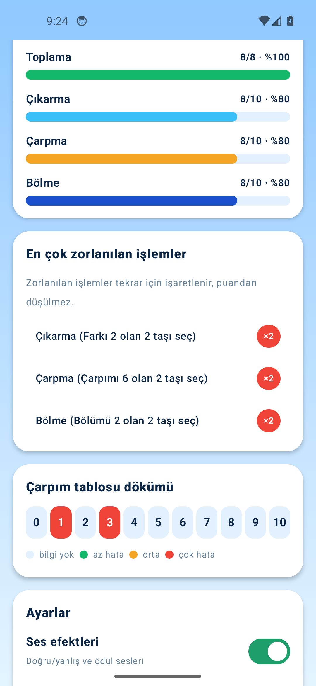 |

> Kareleri yeniden üretmek için: `node tools/capture-screenshots.mjs app/build/outputs/apk/debug/app-debug.apk`
> Orijinal gereksinim listesi: [docs/proje-gereksinimleri.md](docs/proje-gereksinimleri.md)

---

## 🆕 2.0.0 — SIFIRDAN YAZILAN MOTOR

### 1. Tek hedef kuralı: "bazen oluyor bazen olmuyor" bitti
- **Bir bölüm = tek hedef.** Bölümdeki her blok grubu aynı hedefi sağlar (`RuleKind` + `target`),
  arayüzde hangi hedefin aktif olduğu tartışması yoktur.
- **Sıra hiçbir işlemde önemli değil.** `RuleEngine.mathMatches` çıkarmada `|a−b|`, bölmede her iki
  yönü de dener (`8÷2` ve `2÷8` tek kontrolde). Çocuk hangi taşa önce dokunduğunu düşünmez.
- **Sıfır gerçek bir sayı olarak oyunda:** `0+1=1`, `5−5=0` (ikiz sayılar), `0×4=0`, `0÷7=0` bölümleri var;
  sıfıra bölme üretimin hiçbir aşamasında oluşmaz.
- **Geometri iki kuraldan biriyle sabit:** `LINE_OF_SIGHT` (aynı satır/sütun/45° çapraz + aralarında aktif
  blok yok — ters yön dahil) veya `FREE` (yön ve mesafe serbest). Reddedilen her hamle ekranda tek cümleyle
  açıklanır: *"Aralarında taş var, önce onu temizle"* gibi.

### 2. Eşleşmeyen blok bırakmayan tahta üretimi
- Tahta **tersine döşeme** ile kurulur: ızgara baştan 2'li/3'lü bitişik doğru parçalarına bölünür,
  değerler grup grup hedefi sağlayacak şekilde atanır (`BoardBuilder`). Bu yüzden **her bölümde
  eşleşmeyen tek sayı kalmaz** ve planlanan hamle sayısı tahtadan bellidir.
- 100 bloklu **10×10 büyük final** dahil tüm tahtalar 3 farklı tohumla test edilir:
  30 bölüm × 3 tohum = 90 tahta, tamamı sıfır kalan blokla kapanır.

### 3. Tıkanma imkânsız: ALTIN KURTARMA + sihirli blok
- Her doğru hamleden sonra `BoardDoctor` kalan taşlarda geçerli hamle olup olmadığına bakar.
- Hamle kalmadıysa **ücretsiz** (puan/joker/seri gitmez) kurtarma devreye girer: kalan şekil yeniden
  döşenir ve yeniden değerlenir.
- Kalan şekil 2'li/3'lü gruplara hiç bölünemiyorsa **hesapta olmayan sihirli blok** boş/temizlenmiş bir
  kareye eklenir — jokerler bitmiş olsa bile oyun asla bozulmaz.

### 4. Puanlama: günde en fazla 100 puan, jokerler puandan götürür
| Olay | Puan |
|:---|:---|
| Doğru toplama / çıkarma / çarpma / bölme eşleşmesi | **+4 / +5 / +6 / +7** |
| Üç taşlı grup | **+2** |
| 6×6–7×7 tahta / 8×8–10×10 tahta | **+1 / +2** |
| Üst üste doğru seri bonusu | **+0…+8** |
| ⚡ Çifte Hamle aktifken doğru eşleşme | **2 kat** |
| Süreli bölümü erken bitirme | **+1 / +3 / +5** |
| 🔍 İpucu / 🔄 Yeniden Düzenle / ⚡ Çifte Hamle jokersi | **−5 / −10 / −5** |
| Yanlış hamle | **puan gitmez**, sadece seri sıfırlanır |
| **Günlük tavan** | **100 puan** (yeni günde otomatik sıfırlanır) |

- Kazanım (brut) tavana göre, joker harcaması ayrı sayılır: günlük puan **0'ın altına düşmez, 100'ü aşmaz**.
- Hatasız + kurtarmasız bitirilen bölüm **💎 2 elmas**, hatasız ama kurtarmalı **💎 1 elmas**,
  her bölüm bitişi **🪙 10 + tahta boyu + bölüm no** altın getirir.

### 5. 5 gün × 6 bölüm = günde ~60 dakika
| Gün | Dünya | Bölümler (hedefler) | Süre |
|:---:|:---|:---|:---:|
| 1 | 🌲 Sayı Ormanı | +1 · +2 · +5 · +7 · +10 · +10 (serbest) | ~60 dk |
| 2 | 💎 Hazine Mağarası | +13 · +16 · +20 (8×8) · −2 · −0 (ikiz) · −5 | ~60 dk |
| 3 | 🏰 Çarpım Kalesi | −4 · −7 · −10 (8×8) · ×6 · ×12 · ×24 | ~60 dk |
| 4 | 🚀 Bölme Uzayı | ×36 · ÷0 · ÷2 · ÷5 · ×48 (8×8) · ÷6 (8×8) | ~60 dk |
| 5 | 🏝️ Matematik Adası | +25 · −15 · ×54 · ÷8 (süre baskısı) · **+30 10×10 final (15 dk)** · ×30 serbest | ~60 dk |

Bölümler sırayla açılır; yarım kalan tahta cihazda saklanır ve **KALDIĞIN YERDEN DEVAM** ile aynı tahtaya dönülür.

### 6. Çocuk dostu görsel dil ve efektler
- **5 dünya paleti** (orman/mağara/kale/uzay/ada) + ebeveyn paneli paleti: her bölüm kendi dünyasının
  gradyanını, blok rengini ve vurgu rengini alır. Bloklar pastel, rakamlar koyu mürekkep —
  kontrast oranı **9.2:1 – 13.4:1** aralığında (çocuk okuyabilirliği için ölçüldü).
- **Hedef kartı her zaman üstte:** "🎯 HEDEF 7 — Yediye ulaşan komşu sayılar", işlem, tahta boyutu,
  kural adı ve yüzde halkası tek bakışta. Bölümün amacı asla tahmin edilmez.
- Efektler: taşa göre gecikmeli **pop-in** dalgası, seçimde **büyüme + parlama halkası**, seçilen taşlar
  arasında **çizgi çizilmesi**, doğru eşleşmede **parçacık patlaması + uçan puan**, yanlışta **sarsılan
  uyarı şeridi**, bölüm bitiminde **konfeti yağmuru**, ilerleme **halkaları**, ⚡ çifte hamle rozeti,
  ✨ ALTIN KURTARMA afişi, son 20 saniyede **kırmızı nabız atan sayaç**.
- **NASIL OYNANIR kartı** bölüm açılırken kendini gösterir: hedef, geometri kuralı, örnek işlem
  (`Örneğin 3 × 4 = 12`) ve joker maliyetleri.
- Sesler cihazda sentezlenir (PCM, asset yok): doğru/yanlış/bonus/bölüm bitimi; ebeveyn panelinden kapatılır.

### 7. Ebeveyn paneli (gerçek verilerle)
- Bugünkü puan (x/100), toplam işlem, doğru/yanlış, ortalama cevap süresi, günlük oyun süresi.
- Gün gün ilerleme halkaları ve "n/6 bölüm" sayaçları.
- İşlem türü bazında başarı yüzdeleri, en çok zorlanılan işlemler, **çarpım tablosunda 0–10 zorlanma ısı haritası**.
- Ayarlar: ses, süreli/rahat mod, ek süre (−15 / normal / +30 / +60 sn).
- Kontrol edilmeden çalışan iki sıfırlama: **yalnızca bugünün puanı** veya **tüm ilerleme**.

---

## 🛠️ KURULUM VE DERLEME TALİMATLARI

### Android Cihaza APK Kurulumu
1. [`SAYI-AVCISI.apk`](https://github.com/ardaozkul/SAYI-AVCISI/raw/main/SAYI-AVCISI.apk) dosyasını indirin.
2. Dosyaya dokunun, gerekirse *"Bilinmeyen kaynaklardan uygulama yüklemeye izin ver"* seçeneğini onaylayın.
3. İnternet bağlantısı gerekmeden hemen oynayabilirsiniz.

### Kaynak Koddan Derleme
```bash
git clone https://github.com/ardaozkul/SAYI-AVCISI.git
cd SAYI-AVCISI
./gradlew testDebugUnitTest assembleDebug assembleRelease
# debug  -> app/build/outputs/apk/debug/app-debug.apk
# release-> app/build/outputs/apk/release/app-release.apk
```

### Mimari (motor arayüzden ayrı ve test edilebilir)
```
model/GameModels.kt        tek hedefli LevelSpec, Board, BlockCell, RuleKind, MatchRuleMode, JokerType
engine/RuleEngine.kt       geometri + matematik doğrulama (sıra gözetmez), hamle arama, operand üretimi
engine/BoardBuilder.kt     ızgarayı bitişik 2'li/3'lü gruplara bölen garantili tahta üretimi
engine/BoardDoctor.kt      hamle bulma, ipucu, tıkanma tespiti, ALTIN KURTARMA + sihirli blok
engine/CurriculumRepository 5 gün × 6 bölüm müfredatı, hedef metinleri
engine/ScoreEngine.kt      puan, seri, tavan, joker maliyeti, ödüller
engine/GameSession.kt      Compose'dan gözlemlenebilir durum makinesi + kayıt/geri yükleme
engine/ProgressRules.kt    kilit açma sırası, gün ilerlemesi
data/LocalProgressStorage  SharedPreferences: ilerleme, günlük brüt/harcama, yarım kalan tahta, istatistik
ui/GameVisuals.kt          dünya paletleri, gradyanlar, kontrast güvencesi
ui/GameEffects.kt          popIn / shake / pulse / ParticleBurst / FloatingScore / ConfettiRain / ProgressRing / ConnectionLine / GlowRing
ui/GameScreenParts.kt      NumberTile, JokerButton, ObjectiveCard, ScoreBar
ui/GameScreen.kt           oyun ekranı + nasıl oynanır / bölüm bitti / süre doldu katmanları
ui/StartScreen.kt · AdventureMapScreen.kt · ParentPanelScreen.kt · SayiAvcisiApp.kt (yönlendirme)
```

---

## ✅ KALİTE KONTROL VE OTOMATİK TEST SONUÇLARI

`app/src/test/java/com/sayiavcisi/app/EngineRulesTest.kt` motoru sahte depo köprüsüyle (FakeBridge) test eder;
**22 test, 0 başarısız** (`./gradlew testDebugUnitTest`):

1. Sıra gözetmeyen toplama/çıkarma/çarpma/bölme eşleşmeleri — ✅
2. Bölüneni 0 olan ifadede sıfıra bölme asla kabul edilmez — ✅
3. Geçersiz hamle puan düşürmez, yalnızca seriyi sıfırlar — ✅
4. Görüş hattı kuralı: aradaki blok engeller, ters yön ve çapraz serbesttir — ✅
5. Serbest modda yön/mesafe aranmaz — ✅
6. 30 bölüm × 3 tohum: her tahta tamamen kapanır, her grup tek hedefi sağlar — ✅
7. Plan sırasıyla oynanınca tahta koskoca temizlenir — ✅
8. Rastgele oynansa bile asla tıkanılmaz (kurtarma gerekirse devreye girer) — ✅
9. 10×10 büyük final kapanır — ✅
10. Çıkmaz tahtada ALTIN KURTARMA yeniden dizer, tek kalan taşta sihirli blok doğar — ✅
11. Günlük puan 100'ü aşmaz, 0'ın altına düşmez — ✅
12. Jokerler puandan götürür ve hak düşürür — ✅
13. ⚡ Çifte Hamle bir sonraki eşleşmeyi iki katlar — ✅
14. Kaldığı yerden devam: kayıt/geri yükleme + bozuk kayıt güvenliği — ✅
15. Müfredat biçimi: 5 gün × 6 bölüm, günde 55–65 dakika, hedefler kolaydan zora, dört işlem de var — ✅
16. Hedef metinleri çocuğun okuyabileceği biçimde ("Toplamı 5 olan 2 veya 3 taşı seç") — ✅

Ayrıca `assembleDebug` + `assembleRelease` APK'ları emülatörde kurulup **gerçek oyun akışı**
(bölüm açma, eşleştirme, joker, bölüm bitişi, ebeveyn paneli) adb ile oynanarak doğrulandı.
