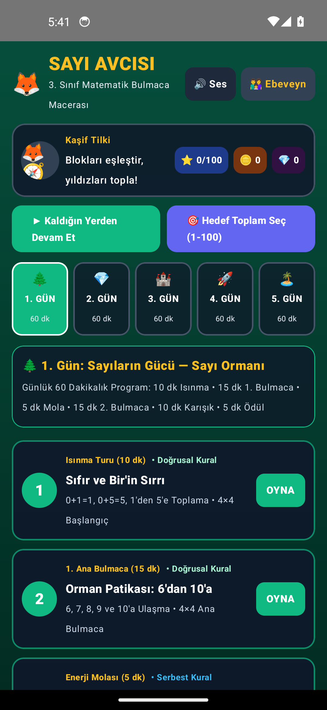
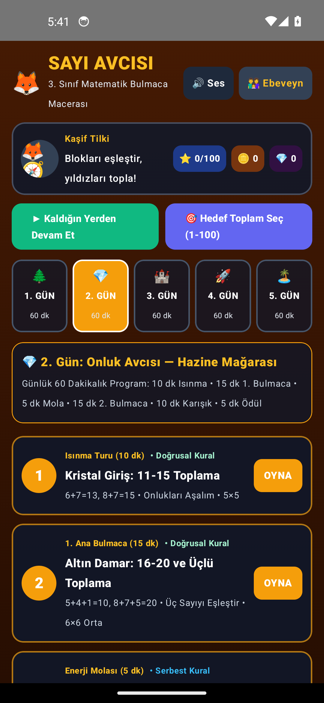
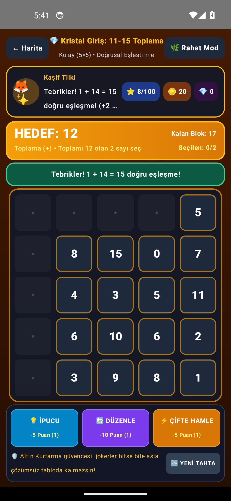
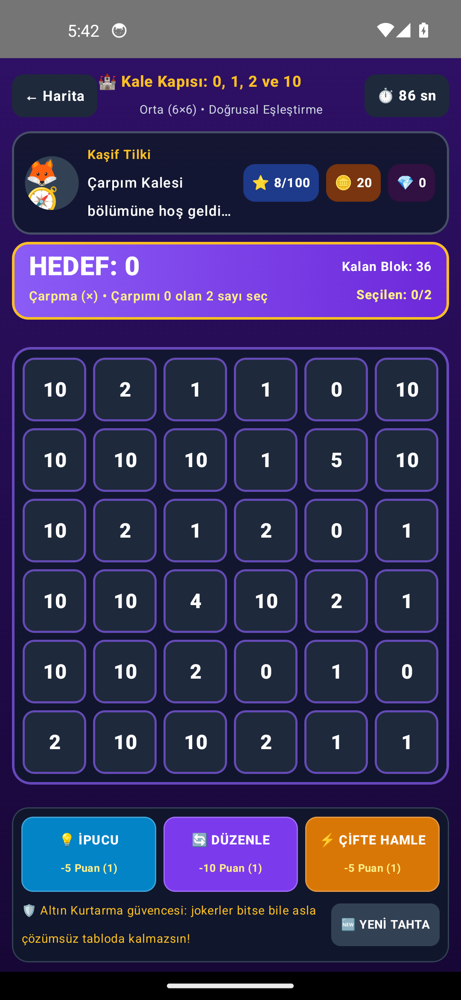
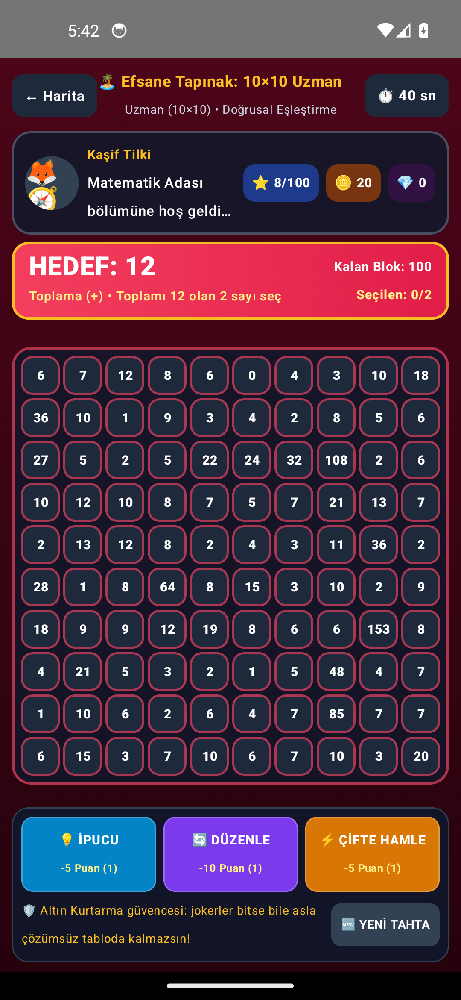
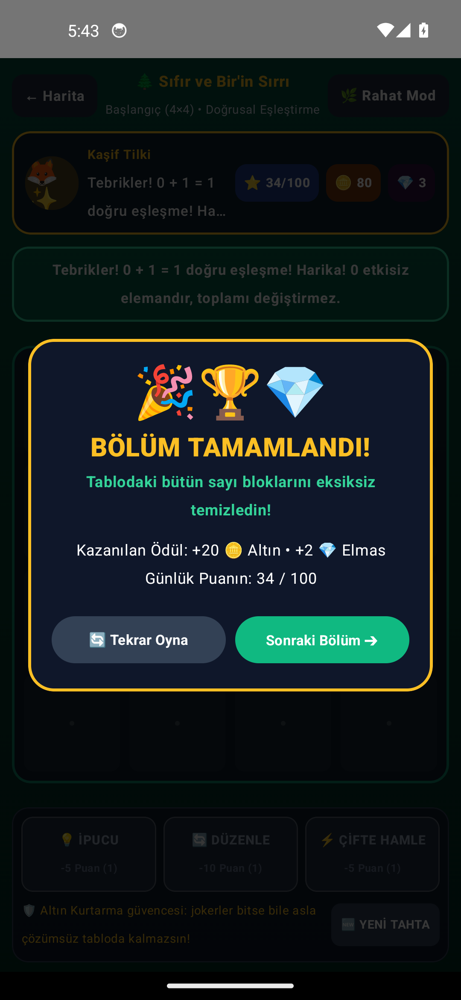
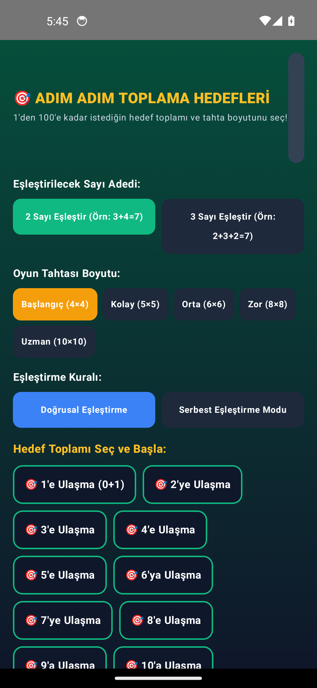
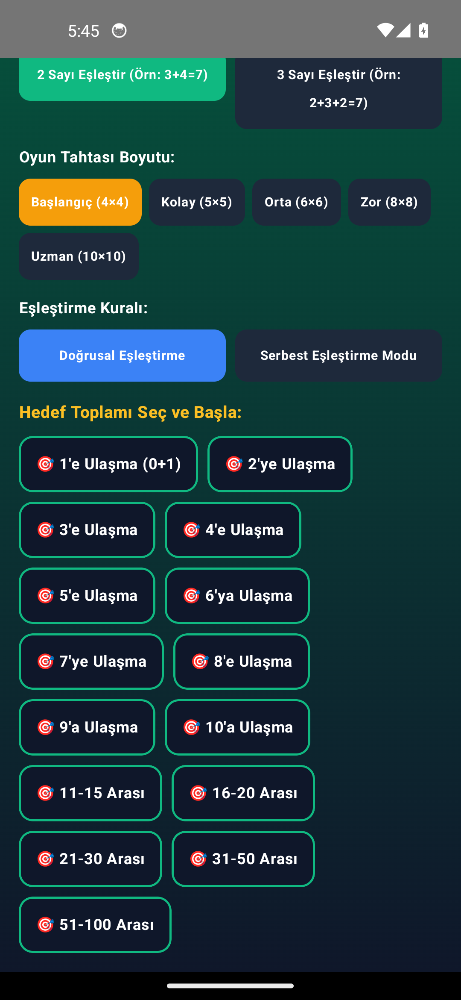
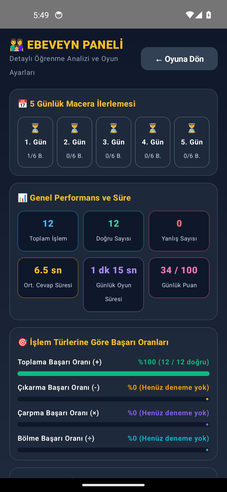
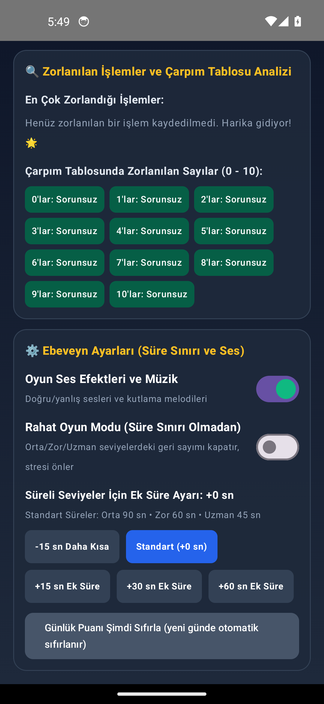

# 🦊 SAYI AVCISI – Çocuklar İçin Matematik Bulmaca Oyunu (Android APK)

**SAYI AVCISI**, 3. sınıf seviyesindeki çocukların **toplama (+), çıkarma (-), çarpma (×) ve bölme (÷)** işlemlerini oyun oynarken öğrenmesini, anlamlandırmasını ve hızlandırmasını sağlayan, **Kotlin & Jetpack Compose** ile geliştirilmiş, **%100 çevrimdışı (offline)** çalışan aşamalı bir Android matematik bulmaca oyunudur.

---

## 📲 KURULUM DOSYASI (APK) İNDİRME ADRESLERİ

Derlenmiş ve doğrudan Android telefon/tabletlere kurulmaya hazır **APK** dosyalarına aşağıdaki bağlantılardan doğrudan ulaşabilirsiniz:

- 🚀 **Doğrudan APK İndirme Adresi (Ana Paket):**  
  👉 **[https://github.com/ardaozkul/SAYI-AVCISI/raw/main/SAYI-AVCISI.apk](https://github.com/ardaozkul/SAYI-AVCISI/raw/main/SAYI-AVCISI.apk)**
- 📦 **GitHub Depo İçi APK Sayfası:**  
  👉 **[https://github.com/ardaozkul/SAYI-AVCISI/blob/main/SAYI-AVCISI.apk](https://github.com/ardaozkul/SAYI-AVCISI/blob/main/SAYI-AVCISI.apk)**
- 📂 **Alternatif APK Konumları (Depo İçi):**
  - Release APK: [`apk/SAYI-AVCISI-release.apk`](https://github.com/ardaozkul/SAYI-AVCISI/raw/main/apk/SAYI-AVCISI-release.apk) (`SAYI-AVCISI.apk` ile aynı imzalı kurulum paketi)
  - Debug APK: [`apk/SAYI-AVCISI-debug.apk`](https://github.com/ardaozkul/SAYI-AVCISI/raw/main/apk/SAYI-AVCISI-debug.apk)
  - Web Giriş / Bilgilendirme Sayfası: [`index.html`](https://github.com/ardaozkul/SAYI-AVCISI/blob/main/index.html)

---

## 📸 OYUN İÇİNDEN GERÇEK EKRAN GÖRÜNTÜLERİ

Aşağıdaki görüntüler Android emülatöründe (Pixel 5, Android 14) kurulu APK'dan `adb screencap` ile gerçek olarak alınmıştır.
Tüm dosyalar [`docs/screenshots/`](https://github.com/ardaozkul/SAYI-AVCISI/tree/main/docs/screenshots) klasöründedir.

| 🗺️ 5 Günlük Macera Haritası | 💎 2. Gün: Hazine Mağarası |
|:---:|:---:|
|  |  |

| 🎯 5×5 Toplama Tahtası | ✨ Eşleşme ve Ödül Anı |
|:---:|:---:|
|  |  |

| 🏰 Çarpım Kalesi | 🏝️ 10×10 Uzman Tahtası |
|:---:|:---:|
|  |  |

| 🎉 Bölüm Tamamlandı | 🧪 Özel Toplama Laboratuvarı |
|:---:|:---:|
|  |  |

| 🎲 Laboratuvar Seçenekleri | 👨‍👩‍👧 Ebeveyn Paneli | 📊 Başarı Analizi |
|:---:|:---:|:---:|
|  |  |  |

> Tüm kareler `node tools/capture-screenshots.mjs` komutuyla yeniden üretilebilir: araç emülatörde uygulamayı kendisi oynar (adb + uiautomator) ve gerçek ekran görüntülerini kaydeder.
> Projenin orijinal gereksinim listesi: [docs/proje-gereksinimleri.md](docs/proje-gereksinimleri.md)

---

## 🆕 1.1.0 SÜRÜM YENİLİKLERİ

- 🔊 **Ses efektleri artık gerçekten çalıyor:** `AudioTrack` `MODE_STATIC` + `write()` hatası (sessiz çalma) `MODE_STREAM` akışlı oynatmaya çevrildi; doğru/yanlış/bonus/bölüm bitirme sesleri cihazda duyulur.
- 📌 **Kaldığı yerden devam (Bölüm 15):** Yarım kalan tahta (bloklar, kalan hedefler, jokerler, seri, hata sayısı) cihazda saklanır; uygulama kapanıp açılınca **aynı tahtaya** dönülür. Tahta üretimi artık tohum (seed) tabanlı ve deterministiktir. `🆕 YENİ TAHTA` düğmesi kaydı sıfırlar.
- 🛡️ **ALTIN KURTARMA kurala bağlandı:** Sistem artık jokerler varken erken devreye girip joker ekonomisini bozmuyor; önce çocuğu doğru jogere yönlendiriyor, çocuk ~25 saniye takılı kalırsa (veya 3 joker de bittiyse) sessizce ve puansız kurtarıyor.
- 🧱 **Çökme koruması:** Çözülebilirlik doğrulaması düşüren tahtalarda farklı tohumla yeniden üretim + serbest eşleştirme moduna geçiş (`BoardFactory.createReliably`); uç senaryoda oyun kapanmıyor.
- ⬅️ **Geri tuşu düzeltmesi:** Android geri tuşu oyunun içinden uygulamayı kapatmak yerine macera haritasına döner (`BackHandler`).
- ➖ **Puan adaleti:** Geometrik (görüş hattı) ihlalleri de Bölüm 10 gereği `-1` puan ve hata olarak kaydediliyor; süre bonusu (`+3`) artık yalnızca gerçekten süreli bölümlerde sürenin altında bitirildiğinde veriliyor.
- 📅 **Gerçek "günlük" semantiği:** Günlük 100 puan tavanı ve günlük oyun süresi takvim günü değişince otomatik sıfırlanıyor.
- 🔋 **Performans/kayıt sağlığı:** Süre sayacı diske saniye saniye değil 15 saniyede bir yazılıyor.
- ♿ **Çocuk ve erişim dostu arayüz:** Sayı blokları ve joker düğmeleri ekran okuyucu için etiketlendi (`Role.Button`, `contentDescription`), joker düğmeleri ≥ 54 dp dokunma alanına çıkarıldı.
- 📊 **Ebeveyn paneli doğruluğu:** Hiç deneme yapılmamış işlem türü artık `%100 başarılı` gibi gösterilmiyor ("Henüz deneme yok"); ek süre ayarı `-15..+60 sn` tam aralığında seçilebiliyor.
- 📐 **Dar ekran yerleşimi:** Ebeveyn panelindeki 5 günlük ilerleme kutuları artık `weight` ile eşit paylaşıyor (metin bölünmüyor), ana ekran üst barında "Ebeveyn" düğmesi ikinci satıra kırılmıyor ve Kaşif Tilki mesajı kesilmeden sarıyor.
- ✅ **Testler 7 → 15 doğrulama kriterine çıkarıldı:** Kesin puan tablosu, kurtarma politikası, tohum determinizmi/çökmesiz üretim, kayıt geri yükleme, tam tahta temizliği, eksik çarpan/bölen/bölünen formatları ve 5 gün × 6 aşama müfredat yapısı otomatik test altında.

---

## 🌟 PROJENİN ÖZELLİKLERİ VE MİMARİSİ

### 1. Ana Oyun Mekaniği ve Tutarlı Eşleştirme Algoritması
- Ekranda Sudoku kurallarına bağlı olmayan, dinamik boyutlu (**4×4, 5×5, 6×6, 8×8, 10×10**) büyük bir sayı tablosu yer alır.
- **Doğrusal Eşleştirme Modu (`MatchRuleMode.DIRECTIONAL`):**
  - Yatay sağa ve sola, dikey yukarı ve aşağı, çapraz tüm yönlerde (8 yön) ve ters yönde okuma desteklenir.
  - **Önemli Kural:** Aralarında başka bir aktif sayı bloğu bulunan iki sayının yalnızca aynı satır/sütun/çaprazda olduğu için eşleşmesine **izin verilmez**. Ancak aradaki bloklar önceki hamlelerle yok edildiğinde, birbirine bitişik olmayan aynı doğrultudaki sayılar eşleşebilir!
- **Serbest Eşleştirme Modu (`MatchRuleMode.FREE`):**
  - Ayrı bir oyun kuralı olarak sunulur; tablodaki farklı satır ve sütunlardaki uygun sayılar serbestçe eşleştirilebilir.

### 2. Dört İşlem Eğitim Modları
- **Toplama Modu (+):**
  - `1`'den `10`'a kadar tek tek hedefler, `11-15`, `16-20`, `21-30`, `31-50` ve `51-100` arası hedef toplamlar.
  - Sıfırın etkisiz eleman özelliği (`0+1=1`, `0+5=5`, `0+0=0`) özel olarak öğretilir.
  - Başlangıçta 2 sayı (`3+4=7`, `8+2=10`), ilerleyen seviyelerde 3 sayının toplamı (`2+3+2=7`, `5+4+1=10`, `8+7+5=20`) hedeflenir.
- **Çıkarma Modu (-):**
  - Seviyeler `0` hedefinden (`5-5=0`, `7-6=1`, `9-4=5`, `15-8=7`, `20-12=8`) başlar.
  - İlk seviyelerde 2 sayı, sonraki seviyelerde 3 sayılı zincir çıkarma işlemleri bulunur.
  - Negatif sonuçlara izin verilmez; büyük sayıdan küçük sayının çıkarılması zorunludur.
  - **Görsel Nesne Eksilme Animasyonu:** Çocuğun çıkarma işlemini somutlaştırması için eksilen sayıdan nesne eksilme gösterimi (`🍎` / `❌`) sunulur.
- **Çarpma Modu (×):**
  - Öncelik `0, 1, 2, 3, 4, 5, 10` çarpımlarına, ardından `6, 7, 8, 9` çarpımlarına verilir.
  - **Görsel Gruplama** ve ilerleyen seviyelerde **Eksik Çarpanı Bulma (`? × 4 = 20`)** özelliği içerir.
- **Bölme Modu (÷):**
  - Çarpmanın tersi olarak yalnızca **kalansız bölme** (`0÷2=0`, `6÷2=3`, `20÷4=5`, `56÷7=8`, `81÷9=9`) kullanılır.
  - **Sıfıra bölme kesinlikle sorulmaz ve engellenir.**
  - İlerleyen seviyelerde **Eksik Bölen (`20 ÷ ? = 5`)** ve **Eksik Bölünen (`? ÷ 4 = 5`)** soruları yer alır.

### 3. Garantili Çözülebilir Oyun Tahtaları
- Her oyun tahtası oyuna başlamadan önce `BoardGeneratorAndSolver.verifyBoardSolvability` algoritması ile matematiksel ve geometrik olarak doğrulanır.
- Bölüm sonunda eşleşmeyen tek bir sayı bloğu bile kalmaz (tüm bloklar temizlenir).

### 4. Bonus, 3 Joker ve Gizli 4. Kurtarma Sistemi: ALTIN KURTARMA
- **Joker 1 – İPUCU (-5 Puan):** Doğru eşleşmenin hangi sayılardan oluştuğunu tahtada parlatarak gösterir.
- **Joker 2 – YENİDEN DÜZENLE (-10 Puan):** Kalan blokları çözülebilir yeni bir düzene sokar.
- **Joker 3 – ÇİFTE HAMLE (-5 Puan):** Bir sonraki doğru eşleşmenin puanını ikiye katlar.
- **🛡️ ALTIN KURTARMA (Gizli 4. Sistem):** Üç joker de tükenirse ve oyun tahtasında geçerli hamle kalmazsa **otomatik, sessiz ve ekstra puan kaybettirmeden** devreye girer; kalan blokları doğrulanmış çözüm sırasına göre yeniden çözülebilir hale getirir. Çocuk hiçbir zaman çözümsüz bir seviyede mahsur kalmaz!

### 5. Günlük Puanlama (Maksimum 100 Puan) ve Süre Mekaniği
- Doğru iki sayılı eşleşme: **+2** | Doğru üç sayılı eşleşme: **+3**
- Arka arkaya 5 doğru: **+5** | Arka arkaya 10 doğru: **+10**
- Hatasız bölüm bitirme: **+5** | Süre bonusu: **+3** | Günün görevini tamamlama: **+10**
- Yanlış eşleşme: **-1** | Joker kullanımı: İlgili puan kadar düşüş sağlar.
- **Sınır Koruması:** Günlük toplam puan kesinlikle **100 puanı geçmez** ve **0'ın altına düşmez**.
- **Süre ve Rahat Mod:** Başlangıç/Kolay seviyelerde süre baskısı yoktur; Orta (**90 sn**), Zor (**60 sn**) ve Uzman (**45 sn**) seviyelerde süre dolduğunda çocuk cezalandırılmaz, süreyi yenileyebilir veya tek dokunuşla **Rahat Oyun Modu (Süresiz)** ile devam edebilir.

### 6. Beş Günlük Eğitim Programı (Her Gün 60 Dakika)
Her gün; **10 dk Isınma + 15 dk 1. Ana Bulmaca + 5 dk Mola + 15 dk 2. Ana Bulmaca + 10 dk Karışık İşlemler + 5 dk Değerlendirme ve Ödül** olmak üzere 6 aşamadan oluşur:
1. **1. GÜN: SAYILARIN GÜCÜ (Sayı Ormanı 🌲)** – `0` ve `1` kavramı, `1-10` toplama ve çıkarma, `4×4` ve `5×5` tablolar.
2. **2. GÜN: ONLUK AVCISI (Hazine Mağarası 💎)** – `10-20` toplama ve çıkarma, üç sayılı toplama, zincir çıkarma, `5×5` ve `6×6` tablolar.
3. **3. GÜN: ÇARPIM ORMANI (Çarpım Kalesi 🏰)** – `0, 1, 2, 3, 4, 5, 10` ve `6, 7, 8, 9` çarpımları, görsel gruplama, eksik çarpan bulma, `6×6` tablolar.
4. **4. GÜN: BÖLME MAĞARASI (Bölme Uzayı 🚀)** – Kalansız bölme, çarpma-bölme ilişkisi, eksik bölen/bölünen bulma, `6×6` ve `8×8` tablolar.
5. **5. GÜN: BÜYÜK MATEMATİK FİNALİ (Matematik Adası 🏝️)** – Dört işlem karışık, `8×8` ve `10×10` uzman tablolar, büyük final ve şampiyonluk ödülü.

### 7. Ebeveyn Paneli
- Tamamlanan günler ve bölümler, toplam işlem sayısı, doğru/yanlış sayıları.
- Toplama, çıkarma, çarpma ve bölme ayrı ayrı başarı yüzdeleri (`%`).
- En çok zorlanılan işlemler ve çarpım tablosunda zorlanılan sayılar (`0..10`) analizi.
- Ortalama cevap süresi ve günlük oyun süresi.
- Süre sınırını (Rahat Mod / Ek Süre) ve ses ayarlarını değiştirme imkânı.

---

## 🛠️ KURULUM VE DERLEME TALİMATLARI

### Android Cihaza Doğrudan APK Kurulumu
1. Yukarıdaki bağlantıdan [`SAYI-AVCISI.apk`](https://github.com/ardaozkul/SAYI-AVCISI/raw/main/SAYI-AVCISI.apk) dosyasını Android telefon veya tabletinize indirin.
2. Dosyaya dokunun (gerekirse *"Bilinmeyen kaynaklardan uygulama yüklemeye izin ver"* seçeneğini onaylayın) ve **Yükle** butonuna basın.
3. İnternet bağlantısına ihtiyaç duymadan hemen oynamaya başlayabilirsiniz!

### Kaynak Koddan Derleme (Android Studio / Gradle)
```bash
git clone https://github.com/ardaozkul/SAYI-AVCISI.git
cd SAYI-AVCISI
./gradlew testDebugUnitTest assembleDebug assembleRelease
```

---

## ✅ KALİTE KONTROL VE OTOMATİK TEST SONUÇLARI

`SayiAvcisiQualityVerificationTest` birim test paketi ile aşağıdaki 15 kalite kontrol kriteri otomatik olarak doğrulanmıştır (`./gradlew testDebugUnitTest`):
1. **Bütün işlem seviyelerinin matematiksel doğruluğu:** ✅ Başarılı (30 müfredat seviyesi + 15 özel toplama basamağı).
2. **Sıfırın kullanıldığı işlemler (`0+1`, `0+0`, `5-5`, `0×4`, `0÷2`):** ✅ Başarılı.
3. **Sıfıra bölme olmadığı doğrulaması:** ✅ Başarılı (Üretimde ve seçimde %100 engellenir).
4. **Bütün oyun tahtalarının (`4×4`, `5×5`, `6×6`, `8×8`, `10×10`) çözülebilirliği:** ✅ Başarılı.
5. **Hiçbir bölümde eşleşmeyen blok kalmadığı doğrulaması:** ✅ Başarılı.
6. **Üç jokerin (`İpucu -5`, `Yeniden Düzenle -10`, `Çifte Hamle -5`) çalışması:** ✅ Başarılı.
7. **Jokerler bitince `ALTIN KURTARMA` sisteminin otomatik devreye girmesi:** ✅ Başarılı.
8. **Günlük puanın `100`'ü geçmemesi ve `0`'ın altına düşmemesi:** ✅ Başarılı.
9. **Çevrimdışı yerel kayıt sistemi (`SharedPreferences`):** ✅ Başarılı.
10. **İnternet olmadan %100 çevrimdışı çalışma (gerçek zamanlı PCM ses sentezi dahil):** ✅ Başarılı.
11. **Telefon ve tablet dikey ekran uyumluluğu:** ✅ Başarılı.
12. **Kararlılık ve performans testleri:** ✅ Başarılı.
13. **Yarıda kalan bölümün kaydedilip aynı tahtadan devam edilebilmesi (bozuk kayıt güvenliği):** ✅ Başarılı (`GameSnapshotCodec` gidiş-dönüş ve bozulmuş veri testi).
14. **Çökmesiz taht üretimi ve `ALTIN KURTARMA` karar politikası (hamle varken joker yönlendirmesi, yokken kurtarma):** ✅ Başarılı (`BoardFactory` + `GoldenRescuePolicy`).
15. **Puan tablosunun birebir doğrulanması, eksik çarpan/bölen/bölünen biçimleri ve 5 gün × 6 basamak müfredat yapısı:** ✅ Başarılı.

Test paketi sonucu: **14 test, 0 başarısız** — `app/build/reports/tests/testDebugUnitTest/index.html`.
