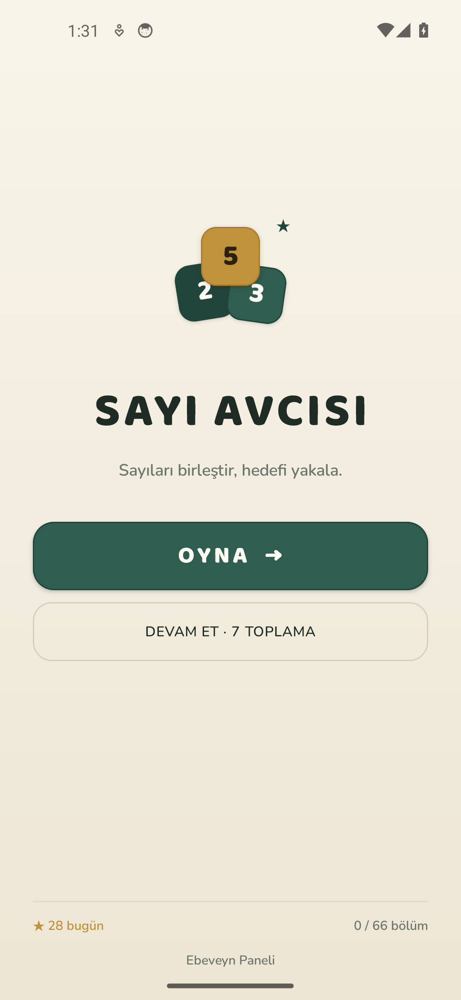
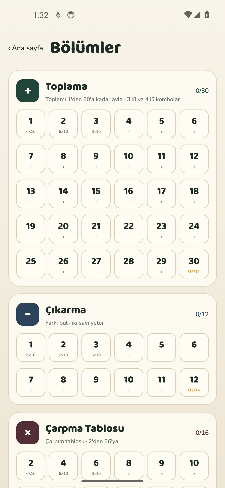
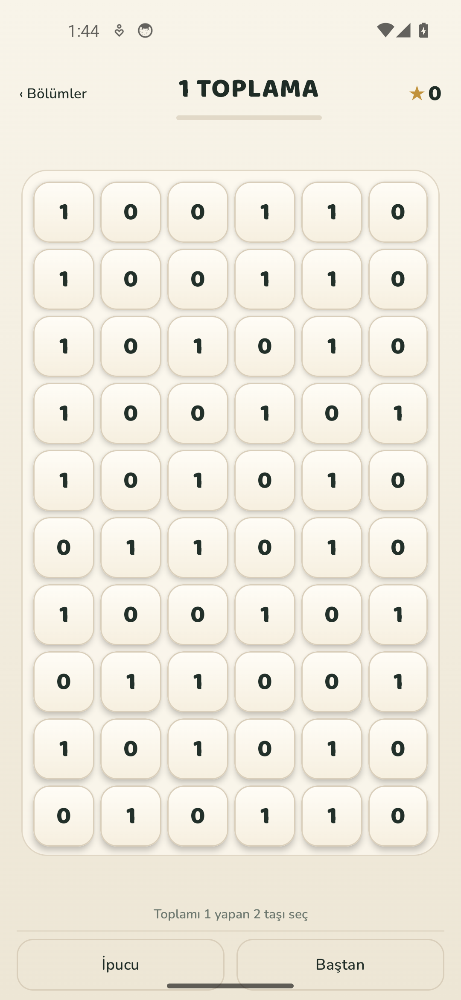
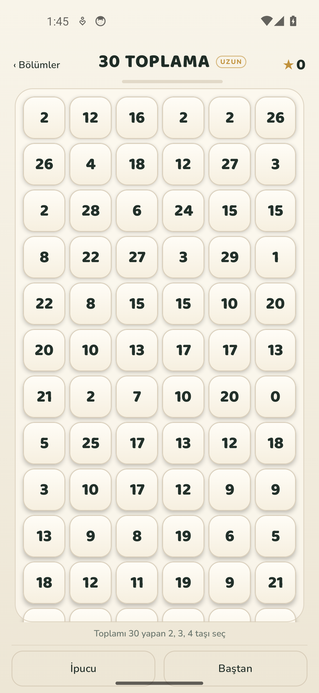
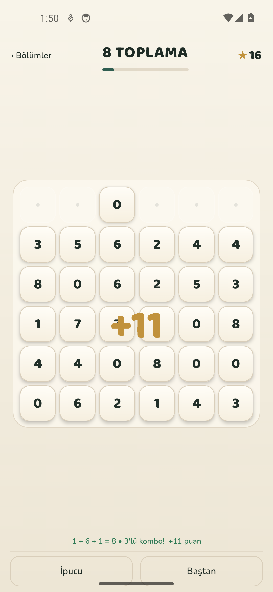
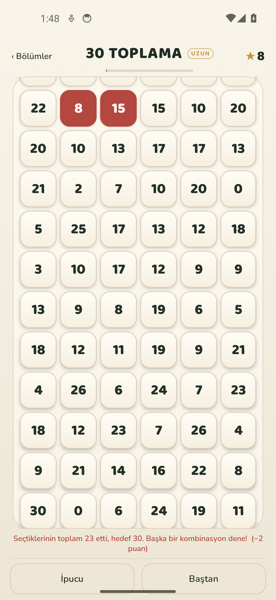

# 🦊 SAYI AVCISI — Çocuklar İçin Sayı Avlama Oyunu (Android APK)

**SAYI AVCISI**, toplama, çıkarma, çarpma ve bölmeyi oyun oynayarak pekiştiren,
**Kotlin & Jetpack Compose** ile yazılmış, **%100 çevrimdışı** çalışan bir Android bulmaca oyunudur.

Bir sayıya basılı tut, parmağını komşu sayılara sürükle ve bırak. Hamle kendiliğinden kontrol edilir:
doğruysa taşlar yeşil parlar, yanlışsa kırmızı olup sarsılır ve puan azalır. Düğmeye basmak yok.

> **4.2.0 daha derin pratik getirdi.** Toplamanın 1–30 arasındaki **bütün** hedefleri artık
> en az **6×50** tahtada oynanır. Çıkarmada önce büyük sonra küçük, bölmede önce bölünen sonra
> bölen seçilir; seçilen taşlarda **1, 2, 3** sıra rozetleri ve kısa süreli sıra uyarısı vardır.
> **Sonsuz Av** komşuluk aramaz; görevler `a × b × c = 21`, `a ÷ b = 4` gibi açık formüllerle yazılır.
> Tema yine mürekkep laciverti, eski kâğıt ve adaçayı yeşili; yeşil Sonsuz Av puanı ayrı kaydedilir.

---

## 📲 KURULUM DOSYASI (APK)

Derlenmiş ve doğrudan Android telefon/tabletlere kurulmaya hazır **APK v4.2.0**:

- 🚀 **Doğrudan indirme (ana paket):**
  👉 **[https://github.com/ardaozkul/SAYI-AVCISI/raw/main/SAYI-AVCISI.apk](https://github.com/ardaozkul/SAYI-AVCISI/raw/main/SAYI-AVCISI.apk)**
- 📦 GitHub üzerinde APK dosyası:
  👉 **[SAYI-AVCISI.apk](https://github.com/ardaozkul/SAYI-AVCISI/blob/main/SAYI-AVCISI.apk)**
- 📂 Alternatif kopyalar:
  - [`apk/SAYI-AVCISI-release.apk`](https://github.com/ardaozkul/SAYI-AVCISI/raw/main/apk/SAYI-AVCISI-release.apk)
  - [`apk/SAYI-AVCISI-debug.apk`](https://github.com/ardaozkul/SAYI-AVCISI/raw/main/apk/SAYI-AVCISI-debug.apk)
- 🌐 **Giriş / bilgilendirme sayfası:** [`index.html`](index.html) — APK adresi, kurulum adımları ve ekran görüntüleri.

**Gereksinim:** Android 7.0 (API 24) ve üzeri · ~12 MB · İnternet gerekmez · İlerleme cihazda saklanır.

### 3 adımda kurulum
1. Telefonun tarayıcısından APK bağlantısına dokun ve dosyayı indir.
2. Android “Bilinmeyen kaynaklardan uygulama yükleme” izni isterse bir kez onayla.
3. “Sayı Avcısı” simgesine dokun; oyun çevrimdışı açılır.

---

## 🎮 NASIL OYNANIR

| Adım | Ne olur |
|:---|:---|
| 1 | Bir sayıya **basılı tut**. Taş mürekkep lacivertine döner. |
| 2 | Parmağını **komşu sayılara sürükle**. Seçilen taşlar koyu lacivert kalır. |
| 3 | Parmağını **bırak**. Hamle otomatik kontrol edilir; “EŞLEŞTİR” düğmesi yoktur. |
| ✓ | Doğruysa taşlar yeşil parlayıp patlar, puan üstteki yıldıza uçar. |
| ✗ | Yanlışsa taşlar kırmızı olup sarsılır ve bölüm puanından **2 puan** gider. |

- **Komşuluk:** Yatay, dikey ve çapraz komşular geçerlidir. Aralarında taş kalmayan uzak sayılar
  da (ör. aynı satırdaki `2` ve `5`) komşu sayılır. Düz giderken çapraza dönebilirsin.
- **Grup boyutu:** Kombolar sınırlı değildir; şartı kaç taşla sağlıyorsan o kadar taş seçersin (en fazla 8).
  Bölme her zaman iki taşlıdır; Sonsuz Av'da görev neyi isterse o kadar.
- **Çıkarmada sıra:** Önce **büyük** sayı, sonra **küçük** sayı seçilir. Sonucu eksi çıkaracak seçim kabul
  edilmez; yanlış sırada seçim puan götürmez, kısa bir “önce büyük, sonra küçük” uyarısı verir.
- **Bölmede sıra:** Önce **bölünen**, sonra **bölen** seçilir. Bölme her zaman iki taşlıdır; yanlış sırada
  seçim yine puan götürmez, “önce bölünen, sonra bölen” uyarısı çıkar.
- **Sıra rozetleri:** Seçilen taşların üzerinde **1, 2, 3** numaraları görünür; çocuk seçim sırasını takip eder.
- **Tek dokunuşla oynayanlar:** Kesinleşen seçim 140 ms içinde değerlendirilir; doğru ya da yanlış geri
  bildirimi anında gelir. Hedefin altında kalan seçim, ek taş ekleyebilmen için kısa süre bekler.
- **Yıldız desteği:** Geçerli hamle kalmazsa oyun ücretsiz olarak kalan taşları yeniden dizer;
  puan/joker gitmez, ekranda yıldız efektiyle duyurulur.

---

## 🆕 4.2.0 — NELER DEĞİŞTİ

### 1. Toplamada daha çok pratik
- Toplama bölümünün **1–30 arasındaki bütün hedefleri 6×50** tahtada oynanır; 6×6 kısa tahta kalmadı.
- Her tahtada 150 grup vardır; çocuk aynı hedefi onlarca kez farklı sayılarla görür.

### 2. Çıkarma ve bölmede sıra kuralı
- Çıkarmada **önce büyük, sonra küçük** seçilir; `küçük − büyük` gibi eksi sonuçlu kombinasyon kabul edilmez.
- Bölmede **önce bölünen, sonra bölen** seçilir; bölme her zaman iki elemanlıdır.
- Yanlış sırada seçim **puan/seri kaybettirmez**: seçim temizlenir ve yaklaşık 1 saniye görünen kısa bir uyarı çıkar.
- Seçilen taşların köşesinde **1, 2, 3** sıra rozetleri görünür.

### 3. Bölme başlığı ve Sonsuz Av görevleri
- Bölme bölümünün üst başlığı “4 bölme” yerine **`a / b = 4`** yazar.
- Sonsuz Av’da komşuluk/hat aranmaz; tahtanın her yerinden taş seçilebilir.
- Görevler kelime yerine açık formüldür: **`a + b + c + d = 57`**, **`a − b − c = 2`**,
  **`a × b × c = 21`**, **`a ÷ b = 4`**.

### 4. Kombolar sınırsız ve karışık yönli
- **Sınır yok:** Çocuk şartı sağlamayı başardığı kadar taş seçer; 2'den 8 taşa kadar kombolar geçerlidir.
  Bölme yine hep iki taşlıdır; Sonsuz Av görevleri formüldeki taş sayısını ister.
- **Bonus merdiveni:** 3 taş +5, 4 taş +12, 5 taş +18, 6 taş +24, 7 taş +30, 8 taş +36.
- **Karışık yön düzeltildi:** Önce çapraz sonra düz gitmek (zigzag), L şekli, düzensiz ama birbirine
  değen kümeler — hepsi artık kombo sayılır. Seçim sırası değil, taşların birbirine bağlı olması geçerli.
  Bağlantısı kopuk seçim yine reddedilir.
- **Erken karar yok:** Hedefe ulaşmadan bırakılan seçim hemen yanlış sayılmaz; çocuğa bir taş daha
  eklemesi için kısa süre tanınır (“Toplam 12 · başka bir sayı daha ekleyebilirsin.”).

---

## 🆕 4.0.0 — NELER DEĞİŞTİ

### 1. Yeni tema ve yazı tipleri
- Turuncu ağırlıklı görünüm tamamen kaldırıldı. Yerine **mürekkep laciverti, eski kâğıt ve
  adaçayı yeşili** geldi; parlak neon gradyan yok, basılmış oyun defteri hissi var.
- Başlıklar **Bricolage Grotesque**, gövde yazıları **Public Sans** ile yazılıyor. İki font da
  projeye gömülüdür; oyun internet olmadan da aynı görünür. Lisanslar `docs/fonts/` altındadır.
- Doğru hamle yeşil, yanlış hamle kiremit kırmızısı; normal puan kâğıt altını, Sonsuz Av puanı yeşil.

### 2. Tahta boyutları ve tablet ayarı
| Bölüm | Tahta |
|:---|:---|
| Kolay hedefler | **6×10** (60 taş) |
| Genel hedefler | **6×6** (36 taş) |
| Bölüm finali | **6×50** (300 taş, dikey kayar) |
| Sonsuz Av | **6×100**; geniş tablette **15×100** |

- Ebeveyn panelinde **Tablet genişliği** ayarı vardır: `Otomatik`, `6`, `9`, `12`, `15` sütun.
- Otomatik mod ekran genişliğine bakar: 1000 dp ve üzeri **15**, 840 dp ve üzeri **12**,
  700 dp ve üzeri **9**, altı **6** sütun.
- Geniş tahtalarda çocuk daha çok sayı görür; satırlar dikey kaydırılır. Çıkarma/çarpma/bölme
  bölümlerinde tek taş artmasın diye sütun sayısı en yakın çift sayıya yuvarlanır; Sonsuz Av
  15 gibi tek sütunlarda da sorunsuz çalışır.

### 3. Sonsuz Av — yeni mod
- Sabit bir başlık yoktur. Üstte o anki **görev formülü** yazar; görev doğru tamamlanınca yenisi gelir.
- Görev sırası: **4 sayı topla → 3 sayı çıkar → 3 sayı çarp → 2 sayı böl** ve baştan tekrar.
- Komşuluk aranmaz; görevdeki sayılar 6×100 tahtanın her yerinden seçilebilir.
- Doğru hamlede temizlenen kareler **anında** yeni sayılarla dolar; tahta hiç boş kalmaz.
- Her görev için tahtaya oynanabilir bir örnek kombinasyon yerleştirilir; “görev var ama
  yapılacak sayı yok” durumu oluşmaz.
- Sonsuz Av puanı **yeşil puandır** ve normal bölümlerin sarı puanına karışmaz. En iyi skor,
  toplam yeşil puan, çözülen görev, oynanma sayısı ve en iyi seri ayrı kaydedilir.
- “Bitir” ile oturum kapatılır; sonuç ekranında yeşil puan ve ayrı rekor gösterilir.

### 4. Daha hızlı tek dokunuş geri bildirimi
- Sürüklemeden tek tek dokunan çocuk için kesinleşen seçim **140 ms** içinde değerlendirilir.
- Doğru kombinasyon anında kabul edilir; geometrisi bozuk ya da hedefi aşan seçim anında reddedilir.
- Toplamada hedefin altında kalan seçim, 3. ve 4. taşı ekleyebilmesi için kısa bir süre bekler;
  çocuk devam etmezse seçim sonuç olarak denenir.
- Sonsuz Av’da görev 4/3/2 taş istiyorsa, o sayı dolmadan karar verilmez.

### 5. Bütün kombinasyonlar eşit
- Tahta, hedefin **tüm** kombinasyonlarını içeren karıştırılmış bir desteden doldurulur.
  “4 toplamı” bölümünde `0+4`, `1+3` ve `2+2` aynı sıklıkta gelir; tek bir kombinasyona sıkışmaz.
- Toplamada `1+2+3`, `1+1+5`, `0+0+7` gibi üçlüler ve `0+1+2+4` gibi dörtlüler de geçerli.
- Toplama ve çarpmada sıra önemsizdir: `1+4` ile `4+1` aynı kabul edilir. 4.2.0’dan beri çıkarma ve
  bölmede ise oyun içi seçim sırası önemlidir (önce büyük/bölünen).
- 3 taşlı komboda **SÜPER KOMBO**, 4 taşlı komboda **MÜTHİŞ KOMBO** kutlaması çıkar.

### 6. Bölüm yapısı — 66 bölüm + Sonsuz Av
| Bölüm | İçerik | Tahta |
|:---|:---|:---|
| ➕ Toplama | 1’den 30’a ardışık hedefler; 3’lü ve 4’lü kombinasyonlar | **6×50 (hepsi)** |
| ➖ Çıkarma | Farkı 1–12 | 6×10 / 6×6 / 6×50 |
| ✖️ Çarpma Tablosu | 2, 4, 6 … 36 (16 hedef) | 6×10 / 6×6 / 6×50 |
| ➗ Bölme | Kalansız bölme, 1–8 | 6×10 / 6×6 / 6×50 |
| ∞ Sonsuz Av | Anlık görevler | 6×100 / 15×100 |

- Kilit yoktur: çocuk veya veli istediği bölümü açıp deneyebilir; tamamlananlar ✓ ile işaretlenir.

---

## 📸 EKRAN GÖRÜNTÜLERİ (4.0.0 görünümü)

Kareler Android emülatöründe gerçek oynanışla alındı; 4.2.0 aynı temayı kullanır ve
yeni sıra rozetleri/uyarıları oyun içinde eklenmiştir.

| Giriş | Bölümler | 6×10 Kolay Tahta |
|:---:|:---:|:---:|
|  |  |  |

| 6×50 Uzun Tahta | 3’lü Kombo | Yanlış Hamle |
|:---:|:---:|:---:|
|  |  |  |

> Eski sürümlerin kareleri [`docs/screenshots`](docs/screenshots) klasöründe tarihsel olarak durur;
> yeni tasarımın kareleri [`docs/screenshots/v4`](docs/screenshots/v4) altındadır.

---

## 🛠️ KAYNAK KODDAN DERLEME

```bash
git clone https://github.com/ardaozkul/SAYI-AVCISI.git
cd SAYI-AVCISI
./gradlew testDebugUnitTest assembleDebug assembleRelease
# debug   -> app/build/outputs/apk/debug/app-debug.apk
# release -> app/build/outputs/apk/release/app-release.apk
```

- Kotlin, Jetpack Compose (BOM 2025.12.01), minSdk 24, targetSdk 35.
- Sürüm: `versionCode 7`, `versionName 4.2.0`.
- Release APK, projede tanımlı debug imzasıyla üretilir; mağaza dışı kurulum içindir.

### Mimari
```
model/GameModels.kt         LevelSpec, Board, BlockCell, MatchResult, EndlessMission
engine/RuleEngine.kt        komşuluk/çizgi geometrisi, matematik + çıkarma/bölme sıra kontrolü
engine/BoardBuilder.kt      garantili tahta döşemesi, kombinasyon destesi, 6×100 Sonsuz tahta
engine/EndlessMissionFactory.kt  anlık Sonsuz Av görevleri ve örnek kombinasyonlar
engine/BoardDoctor.kt       ipucu, tıkanma tespiti, yıldız desteği
engine/CurriculumRepository 4 bölüm / 66 bölüm + Sonsuz Av, tablet sütun ayarı
engine/ScoreEngine.kt       puan, kombo bonusu, yanlış ceza, ödüller, yeşil puan
engine/GameSession.kt       sürükleme/dokunma, anlık kontrol, Sonsuz Av, kayıt/geri yükleme
engine/ProgressRules.kt     bütün bölümler açık, tamamlanan işaretleri
data/LocalProgressStorage   SharedPreferences: ilerleme, ayarlar, yeşil puan rekorları
ui/GameScreen.kt            oyun ekranı, sürükleme katmanı, kombo ve Sonsuz Av başlığı
ui/GameScreenParts.kt       taş (kâğıt/lacivert/yeşil/kırmızı), yazılı düğmeler
ui/GameEffects.kt           popIn, shake, parçacık, yıldız, konfeti, halka, çizgi
ui/AppFonts.kt              Bricolage Grotesque + Public Sans
ui/StartScreen.kt           sade giriş
ui/AdventureMapScreen.kt    dört bölüm kartı + Sonsuz Av ve hedef çipleri
ui/ParentPanelScreen.kt     ebeveyn paneli (istatistik/ayarlar/yeşil puan kayıtları)
```

---

## ✅ TESTLER

`app/src/test/java/com/sayiavcisi/app/EngineRulesTest.kt` — **37 test, 0 başarısız**:

- Toplamada bütün ikili/üçlü/dörtlü kombinasyonlar kabul edilir; ters sıra da geçerli.
- `0+4`, `1+3`, `2+2` aynı tahtada bulunur (eşit dağıtım).
- 3 sayılı çıkarma (`a−b−c`) ve çarpma (`a×b×c`) kuralları doğru çalışır.
- Çıkarmada önce büyük sonra küçük, bölmede önce bölünen sonra bölen zorunludur; ters sıra puan götürmez.
- Eksi sonuçlu çıkarma kombinasyonu reddedilir; bölme her zaman iki elemanlıdır.
- Toplama 1–30’un tamamı en az 6×50 tahtadadır.
- Sonsuz Av FREE moddadır (komşuluk aranmaz) ve görev başlıkları açık formüldür.
- Düz giderken çapraza dönme ve aralarında taş kalmayan uzak sayılar geçerli.
- 66 bölüm × 2 tohum: her tahta tamamen kapanır, her grup hedefi tutar.
- Tablet sütunları (6/9/12/15) tahtayı tamamen kapatır; tek sütunda boş taş kalmaz.
- Sonsuz Av görevi anında oynanır, temizlenen kare yenilenir ve yeşil puan ayrı kaydedilir.
- Plan sırasıyla oynanınca tahta temizlenir; rastgele oynanınca yıldız desteği devreye girer.
- 4 taşlı komboda +12 kombo bonusu ve kutlama tetiklenir.
- Yanlış hamlede −2 puan ve seri sıfırlanır.
- Günlük tavan bölüm puanını kesmez; kayıt/geri yükleme ve joker hakları çalışır.
- Müfredat: 30 toplama + 12 çıkarma + 16 çarpma + 8 bölme + Sonsuz Av; hepsi açık.

Ayrıca yeni APK emülatörde kurulup gerçek parmak sürükleme (2’li ve 3’lü kombo), doğru/yanlış
geri bildirimi, 6×10 ve 6×50 tahtalar, kaydırma ve kombo kutlaması adb ile oynanarak doğrulandı.

---

## 🔒 GİZLİLİK

- Hesap, reklam, analitik ve ağ izni yoktur.
- Bütün ilerleme ve istatistikler yalnızca cihazdaki `SharedPreferences` içinde tutulur.
- Ebeveyn panelinden ses, süreli/rahat mod, tablet genişliği ve ilerleme sıfırlama yönetilebilir;
  normal puanlar, yeşil Sonsuz Av puanları ve rekorlar ayrı ayrı görülebilir.
